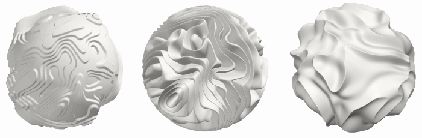

# Parametric 3D Stuff Generators Warehouse

Some parametric generators of relief 3D textures and printable models, all with STL export. Dimensions are in millimetres.

| Folder | What it does |
| --- | --- |
| [`relief/`](relief/) | Noise patterns: topography (terraces), contour lines, fibres, dunes, Voronoi cells, rings, mountains (ridges), spikes, gyroid and other TPMS. Rectangular, round or polygon panel, cylinder, tube/vase, cube/box, sphere, torus. |
| [`waves/`](waves/) | Interference of circular waves from several sources (moiré effect). |
| [`tiles/`](tiles/) | Modular wall installations made of separate pieces: pyramids, spikes, tilted blocks, cylinders, drops. Rectangular, radial and hexagonal grids. Export the whole installation, each piece, or per printer bed, plus a 1:1 assembly map. |
| [`ornament/`](ornament/) | Relief decorative tiles: square, hexagon, octagon, circle. The ornament is built from motif layers (rosettes, scrolls, leaves, stars, girih, frames, fluting, facets). Tile arrays with rotations and relief fade towards the edges. Export a single tile, the whole array, or every tile in a ZIP. |
| [`brutalist/`](brutalist/) | Brutalist concrete relief with crisp faces: rubble, blocks, pyramids, ribs, folds. Export: STL (monolith or exact solids) and a 16-bit heightmap. |
| [`glyphs/`](glyphs/) | A wall of concrete letter tiles: each letter is a crease ridge with slopes running down to the base. Text (Latin letters, digits) is laid out on a grid; a space is a flat cell of adjustable height, `^` and `~` are a pyramid and a funnel. Export: STL of the whole panel, a ZIP with every unique tile and a layout map, a 16-bit heightmap. |
| [`wood/`](wood/) | Wood relief: growth rings modelled as a cut through a log (quarter-sawn, cathedral arches, figure), knots with rings flowing around them and radial checks, cross and lengthwise cracks, charring/weathering. |
| [`layers/`](layers/) | Overlapping wavy plates: stripes, rings or contours bent by noise. Shingles or terraces, rounded edges, shadow gap, lip, pinch-out, fibres and fine lines. |
| [`stones/`](stones/) | Faceted stones: irregular stones of mixed size with rounded edges, separated by joints. Tops carved with facets, V-folds (chevrons) and scoops. From plaster wall panels to cut pebbles and flagstones. |
| [`khrushchyovka/`](khrushchyovka/) | Soviet five-storey blocks of flats as printable models: large-panel, large-block or brick walls, entrances with canopies, stairwell windows, balconies or loggias, flat, gable or hip roof, lived-in details. Self-supporting overhangs, hollow shell with windows cut through for lighting, split into parts with pin holes. |

See the README in each folder for details.
