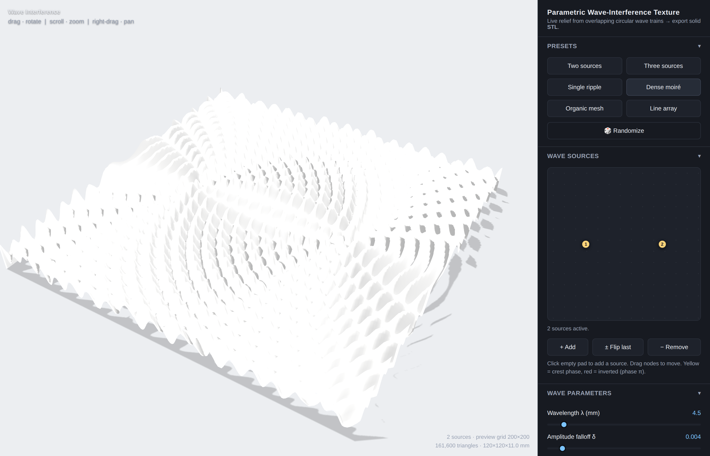

# Wave Interference — Parametric 3D Texture Generator

A single-page tool that generates **3D relief textures from overlapping circular
wave trains** (the ripple-tank / moiré interference look) and exports them as a
**watertight, printable STL**.



## Usage

Just open **`index.html`** in any modern browser (double-click works — Three.js
is vendored locally in `vendor/`, so no internet connection is required).

- **Drag** to rotate · **scroll** to zoom · **right-drag** to pan.
- Click the **source pad** to add wave sources; drag the nodes to move them.
  Yellow = crest phase, red = inverted (phase π).
- Tweak everything live, then **Export STL**.

## How it works

Each source *i* emits a circular wave; the surface height is the summed field:

```
h(x, y) = Σ  Aᵢ · e^(−δ·rᵢ) · cos( 2π·rᵢ / λᵢ + φᵢ )
```

where `rᵢ` is the distance from point `(x, y)` to source *i*. The field is
normalized to `0..1`, reshaped (signed / rectified / ridged), and mapped onto a
height grid. The mesh is a solid slab (top surface + flat bottom + side walls),
so the STL is manifold and slicer-ready.

## Parameters

| Group | Controls |
|-------|----------|
| **Presets** | Two/three sources, single ripple, dense moiré, organic mesh, line array, randomize |
| **Wave sources** | Add / remove / move / flip phase, interactively on a 2D pad |
| **Wave** | Wavelength λ, amplitude falloff δ, falloff model (exp / linear / none) |
| **Shaping** | Waveform (signed / rectified / ridged), contrast, gamma, smoothing, invert |
| **Mesh & dimensions** | Footprint X/Y (mm), relief height (mm), base thickness (mm), preview grid |
| **Appearance** | Material (plaster / matte / clay / dark resin), wireframe |
| **Export** | Export grid resolution, solid base toggle, binary STL download |

All dimensions are in **millimetres** — the exported STL drops straight into a
slicer at the intended physical size.

## Files

```
index.html            the app (UI + geometry + STL exporter)
vendor/three.min.js   Three.js r128 (MIT) — rendering
vendor/OrbitControls.js  camera controls (MIT)
```
