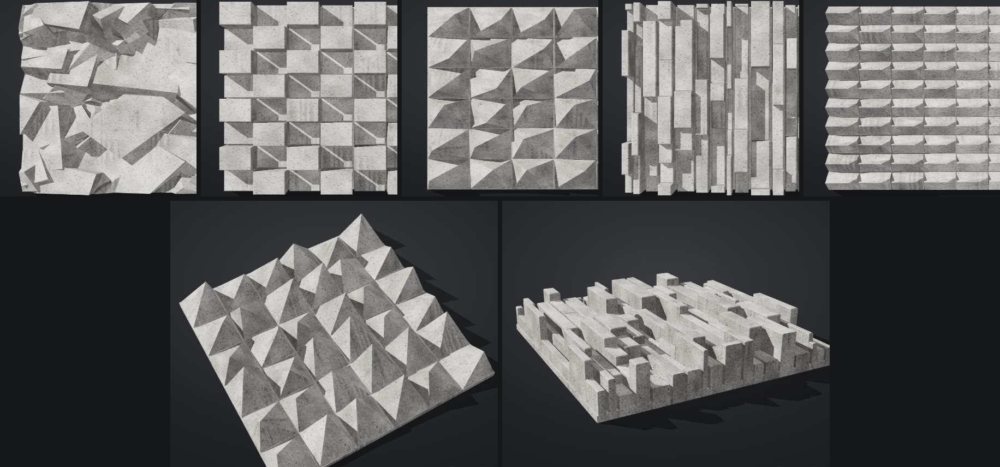

# Brutalist Surface

Параметрический генератор бруталистского бетонного рельефа. Один HTML-файл, всё
считается в браузере. Размеры в миллиметрах, экспорт в **STL** и **16-битную карту высот**.



## Запуск

Откройте `index.html` в браузере — сборка не нужна (Three.js лежит в `vendor/`).

- **ЛКМ** — вращение, **колесо** — зум, **ПКМ** — панорама
- Кнопки внизу слева: **Фасад** (вид в лоб, как на фото), **3/4**, **Скользящий**
- `R` — случайный сид, `F` — вид «Фасад»
- «Скопировать ссылку» — все параметры хранятся в адресе страницы

## Паттерны

Каждый паттерн повторяет свой архитектурный референс.

| Паттерн | Что получается | Главные параметры |
| --- | --- | --- |
| **Обломки** | Наклонённые бетонные блоки, наваленные друг на друга. | количество, размер, пропорция, наклон, разброс высоты |
| **Блоки** | Стена из выступающих кубов. Рисунок выноса: шахматка, диагональ, случайно, градиент, волна, шум. | сетка, уровни, перевязка рядов, шов, фаска, наклон грани |
| **Пирамиды** | Гранёные пирамиды со смещённой вершиной на квадратной, ромбической или треугольной сетке. | смещение вершины, направление (случайно / одно / чередование / от центра / поток) |
| **Рёбра** | Ламели разной ширины из сегментов разной глубины, стыки вразбежку. | количество, разброс ширины, длина сегментов, уровни, зазор |
| **Складки** | Панели со сломанной гранью; сила излома меняется градиентом по плите. | линия и скос излома, точка перелома, градиент |

**Плита** — ширина, длина, толщина основания и глубина рельефа (над основанием).
**Свет и материал** влияют только на превью: азимут и высота солнца, бетон/пластик,
фактура бетона, разброс тона между элементами.

Все паттерны бесшовно тайлятся. Исключения — градиенты и режим «от центра»:
они по своей природе не периодичны.

## Экспорт

| Кнопка | Что это | Когда нужно |
| --- | --- | --- |
| **STL — монолит** | Единая замкнутая сетка по карте высот (шаг задаётся слайдером). | 3D-печать, CNC, любой софт, требующий manifold-сетку |
| **STL — точные тела** | Каждый элемент — отдельное замкнутое выпуклое тело с точными гранями. Тела пересекаются с основанием; слайсеры (Prusa, Bambu, Cura) объединяют их сами. | рендер, лёгкий файл, идеально острые рёбра |
| **PNG 16 бит** | Карта высот: чёрный — основание, белый — максимум рельефа. Верх картинки — дальний край (Y). | displacement в Blender/Unreal, CNC по карте высот |

Модель строится Z-вверх: дно на `z = 0`, рельеф сверху — готово «дном на стол».

## Как устроено

Каждый элемент рельефа описывается набором точек и превращается в выпуклую оболочку.
Дальше оболочка обрезается плоскостями по габаритам плиты. Поэтому грани точные, а
тела на краях честно подрезаны, что даёт бесшовность. Для монолита сверху по сетке
пускаются вертикальные лучи и ищется верхняя точка объединения тел; из результата
собирается замкнутая сетка.

Геометрическое ядро находится в `index.html` между маркерами `CORE:BEGIN` / `CORE:END`
и не зависит ни от DOM, ни от Three.js.

## Тесты

```bash
cd brutalist && npm test
```

Тесты проверяют:

- каждое тело каждого паттерна замкнуто, ориентировано наружу и лежит внутри плиты;
- монолит водонепроницаем, а его противоположные края совпадают (бесшовность);
- бинарный STL и 16-битный PNG корректны (включая CRC и распаковку).
