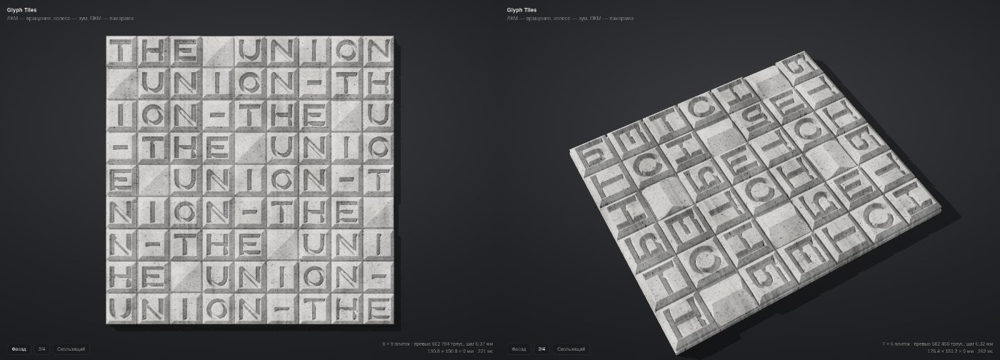

# Glyph Tiles

A parametric generator of a wall of concrete letter tiles: text runs across a grid, each
letter is a separate tile. The letter is neither engraved nor embossed: it is itself a **crease**, a ridge
on top of the tile from which flat slopes run down to the base. Where the slopes from two strokes
meet, a valley forms; the letter reads through light and shade on the faces.
A single HTML file, everything is computed in the browser. Dimensions in millimetres, export to **STL**.

## Running

Open `index.html` in a browser — no build step needed (Three.js is in `vendor/`).

- **Left mouse** — rotate, **wheel** — zoom, **right mouse** — pan
- Buttons at the bottom left: **Front** (straight-on view), **3/4**, **Grazing**
- `R` — random seed, `F` — "Front" view
- "Copy link" — all parameters, including the text, are stored in the page URL

## Parameters

| Group | What it controls |
| --- | --- |
| **Text** | A multi-line field and the layout order: line by line as typed (each line of the field is a row of tiles, missing cells are empty), lines in sequence, snake, with each row shifted (like the "THE UNION" facade), by columns, by diagonals, random. Preset buttons. |
| **Grid and tile** | Columns and rows, tile size, joint, border margin, base thickness, tile height, chamfer width and depth, tile offset spread, seed. |
| **Letters** | Construction: **crease** (default — the letter is a ridge with slopes down to the base, steepness set by the slope angle; or "to the tile edge" — the slope is stretched so it reaches the base exactly at the edge, and the chamfer is not cut in this mode so no narrow pits remain at stroke ends), or a regular engraved / embossed stroke (thickness, depth, wall bevel). Letter inset from the chamfer; profile — flat faces or concave (bowl, parabola: the slope at the ridge is finite, so the edge is not jagged); the bowl has "Ridge rounding" (default 0.5 mm, 0 — off): it slightly rounds the crease so curved ridges (O, U, S…) don't come out saw-toothed on the grid; with flat faces the ridge is always sharp; stroke ends are square (faceted) or round; random rotation and mirroring of tiles. |
| **Space** | A flat cell; its height above the base is set by the "Space height" slider (0 — base level, no tile; above 0 — a flat tile without a chamfer, also included in the ZIP). In the text, `^` places a pyramid and `~` a funnel; their height is set separately. |

The font is a custom "skeleton" font: Latin A–Z, digits 0–9 and the hyphen. Case does not matter. Characters missing from the font
become empty cells, and a list of them is shown in the top left corner.

## Export

| Button | What it is |
| --- | --- |
| **STL — whole panel** | The entire wall as one closed mesh: base, joints and tiles. |
| **ZIP — tile set** | Each unique tile as a separate STL (`tile-A_x8.stl` — the letter and how many are needed) and `layout.txt` — a layout map with rotation angles. Tiles are exported unrotated: rotation is applied when laying them. Mirrored variants are separate files. |
| **PNG 16-bit** | Heightmap of the panel: black is `z = 0`, white is the top of the relief. |

The model is built Z-up: the bottom is at `z = 0`, ready to print "bottom on the bed". Accuracy is set by "Mesh step".
About 0.25 mm is enough for printing; a 19 × 19 cm panel then weighs about 64 MB.

## How it works

Each letter is described by its centre line in a unit square: polylines, circular arcs
and dots. For each point of a tile the distance to this line is computed, and the height drops from the top
of the tile proportionally to it (the "Slope angle") down to the base. So the letter's line is
a sharp ridge; in N, triangular faces and valleys form between the three ridges; in O
a funnel forms inside the ring; in E a "louvre" forms between the bars. The chamfer along the tile edge
cuts the slopes and forms a frame. At free stroke ends and at right angles the distance
is measured "squarely", so the ridge ends are faceted like a hip roof.

The surface is a heightmap on a rectangular grid. Exact lines of tile edges, chamfers and pyramid apexes
are added to the uniform step, so joints are vertical and edges are sharp.
In each cell the height is also sampled at the centre, and the cell is split along the diagonal that
matches it better: this keeps diagonal faces from getting saw-toothed.

The geometry core lives in `index.html` between the `CORE:BEGIN` / `CORE:END` markers and
depends on neither the DOM nor Three.js.
