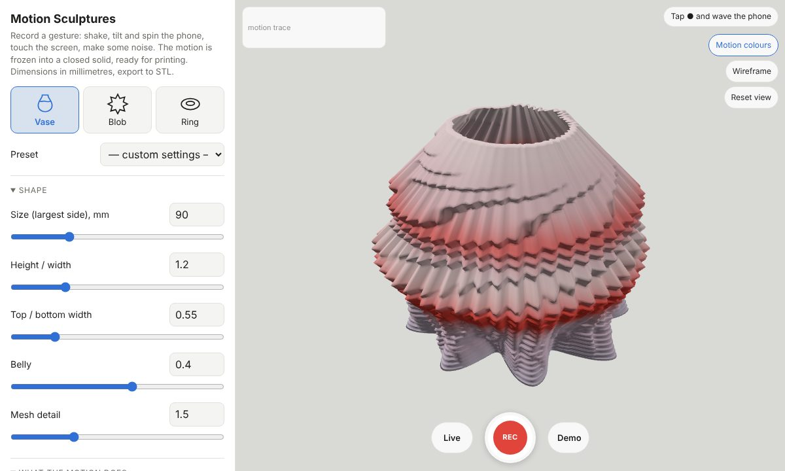

# Motion Sculptures

A parametric generator of abstract solids sculpted by moving a phone. Record a
gesture: shake, tilt and spin the phone, touch the screen, make some noise. The
gesture is frozen into a vase, a blob or a ring. Dimensions in millimetres, the
result is exported to binary STL: a closed, two-manifold solid with a flat
bottom, ready for a slicer.

## Running

Everything is in a single `index.html` file. No build step needed, three.js is
loaded from a CDN (internet connection required). The interface is made for a
phone first, with a side panel on wide screens.

Motion sensors and the microphone only work on a secure page: open it over
`https://` (for example GitHub Pages) or from `localhost`, not from
`file://` or a plain `http://` address on the local network. On iOS the
first tap on ● or Live asks for motion access.

Without motion sensors (a desktop) the pointer stands in for the phone: its
position over the view is the tilt, its speed the shake, circling around the
centre the spin. "Demo" makes a random synthetic gesture.

## Recording

- **● (REC)** records a take of "Duration" seconds, after an optional 3‑2‑1
  countdown. The ring around the button shows progress, the phone buzzes on
  start, on strong shakes and at the end. Tap again to stop early.
- **Live** keeps rebuilding the shape from the last "Duration" seconds of
  motion; tap **Freeze** to keep what you see.
- The screen is kept awake while recording (Wake Lock), the view turns by
  itself and touching it counts as "touch" instead of orbiting.
- The small trace in the corner shows shake (red), rotation (blue), sound
  (green) and touch (grey) for the last 4 seconds.

The take is resampled to 192 frames and saved in the page URL together with
the parameters (about 2.6 kB), so "Copy link" shares the exact sculpture.

Sensors used: `devicemotion` (linear acceleration, acceleration including
gravity, rotation rate), the microphone via Web Audio (optional), touch,
`navigator.vibrate` for feedback and the Screen Wake Lock.

## How the motion is mapped

Every gesture has these signals at every moment:

| Signal | From | Does |
| --- | --- | --- |
| Shake | length of the linear acceleration, as an envelope | **bulge**: the section grows |
| Tilt | gravity in the phone frame, relative to the pose at the start of the take | **lean**: the section shifts that way |
| Rotation | length of the rotation rate | **lobes**: depth of a petal pattern |
| Spin | rotation around the screen axis, integrated into an angle | turns the lobes ("Follow spin" = 1 turns them exactly as the phone turned) |
| Shake direction | direction of the acceleration | **spikes** of the blob, pointing where you shook |
| Sound | microphone loudness | **ripples**: fine flutes or grooves |
| Touch | a finger on the view | **pinch**: squeezes the section |

"Sensitivity" scales all of it, "Smoothing" blurs the signals in time,
"Extra spiral" adds a fixed twist of the lobes. "Motion colours" in the view
paints the surface by how hard the phone was shaken (red) and turned (blue) at
that moment; it is only for the preview.

## Forms

- **Vase**: time runs from the bottom up, every layer is a moment of the take,
  its section a polar curve around the vertical axis. Base profile: height /
  width, top / bottom width, belly. "Hollow" makes a vase-mode shell with a
  given wall and bottom thickness (the wall is offset along rays from the
  axis, so it gets thinner across steep lobes). "Limit overhangs to 45°" lets
  the wall grow outwards (and, when hollow, inwards) by at most one layer
  height per layer, so it prints without supports.
- **Blob**: a star-shaped solid around a centre; latitude is time (the bottom
  is the start). Every shake pushes a spike out in its direction, turned with
  the phone's spin.
- **Ring**: the take loops around a torus, every cross-section is a moment.
  The signals are blended into a loop and the spin is rounded to a whole
  number of lobe steps, so the seam is invisible.

All forms are grids of rings closed by fans, with radii measured along rays
from an axis or a centre and kept positive, so the solid is closed,
two-manifold and cannot cross itself. "Flat bottom" (blob, ring) clips the
rays below the centre by a plane at a share of the lowest radius. "Thinnest
radius" keeps narrow parts printable. The whole solid is scaled so that its
largest side equals "Size". The summary shows the dimensions, volume (and the
weight of solid PLA), triangle count and the result of a mesh check: every
edge shared by exactly two triangles, in opposite directions, positive
volume. Export refuses a mesh that fails the check.

## Code

A single `<script type="module">` in `index.html`, sections:

- `gesture`: channels, resampling, URL encoding, synthetic demo gestures
- `signals`: smoothing, shake and rotation envelopes, spin phase, loop blending
- `params`: parameter schema and presets
- `mesh`: vase, blob and ring builders, mesh check
- `stl`: binary STL
- `sensors`: device motion, microphone, fixed-rate sampler, pointer fallback
- `main`: UI, recording, three.js preview, export and sharing

`window.motionSculpture` exposes `buildMesh`, `checkMesh` and `demoGesture`
for automated checks.
