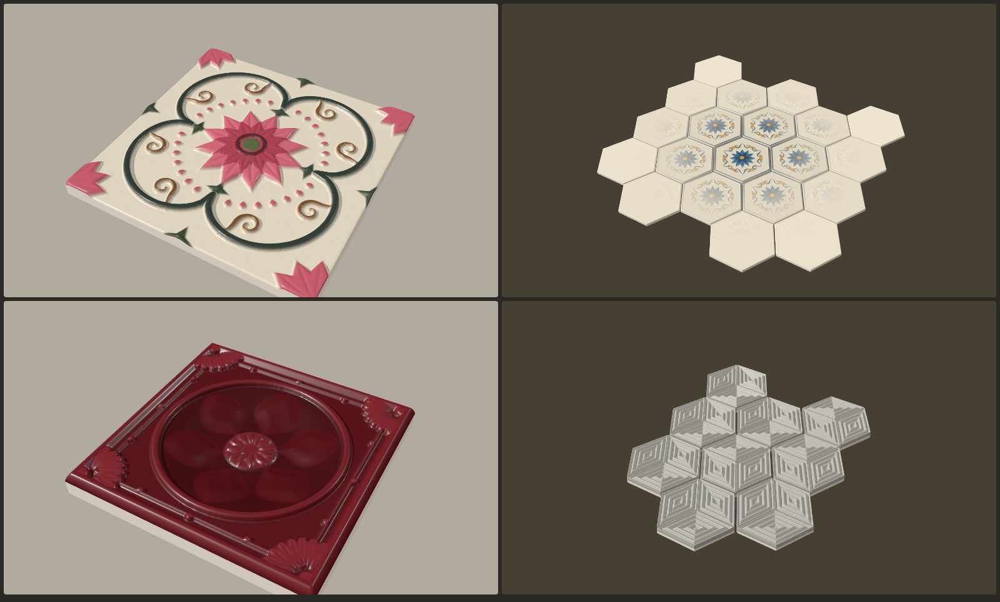

# Ornament — генератор рельефной плитки

Параметрический генератор объёмной керамической плитки: розетки, завитки, листья, рамки,
звёзды, гирих, рифление, грани. Плитка бывает квадратной, шестиугольной (гранью или углом вверх),
восьмиугольной и круглой. Её можно собрать в массив, где рельеф затухает к краям.
Все размеры задаются в **миллиметрах**, экспорт в **STL**.



## Запуск

Открыть **`index.html`** в браузере (можно двойным кликом). Three.js лежит в `vendor/`,
интернет не нужен. Параметры сохраняются в браузере между сессиями.

## Как устроено

Плитка — это основание толщиной `T` и рельеф над ним. Рельеф складывается из **слоёв**,
каждый слой — один **мотив**, размноженный по плитке.

### Мотивы

| Мотив | Что это |
| --- | --- |
| Лепесток / лист | Лист, лепесток, капля, ромб. Задаются изгиб (серп, завиток листа), острота концов, место наибольшей ширины, вырез-сердечко, прожилка. |
| Круг / кольцо / сектор | Точки, кольца, полудиски. |
| Прямоугольник | Бруски и квадраты со скруглёнными углами. |
| Завиток | Спираль с хвостом: радиусы, число витков, толщина по длине, изгиб хвоста, шарик в центре. |
| Кривая (стебель) | Кубическая кривая Безье с переменной толщиной и шариками на концах. |
| Дуга | Часть окружности заданной толщины. |
| Полоса | Прямая лента, например диагональные ремни азулежу. |
| Звезда | Звезда с N лучами. С профилем «Фаска» получаются гранёные лучи с острым ребром. |
| Звёздный многоугольник {n/k} | Линии через каждую k-ю вершину n-угольника — основа гириха. |
| Лопастной контур | Четырёх-, шести- и многолистник. В режиме «только контур» даёт переплетённые ремни. |
| Рамка по краю | Полоса вдоль контура плитки на заданном отступе. |

### Рельеф слоя

- **Режим**: *наплыв* (максимум с тем, что уже есть), *наложение* (поверх), *вырезать* (углубление, например чаша).
- **Профиль склона**: скруглённый, фаска (грани), плавный, вогнутый; ширина склона в мм.
- **Заливка** сплошная или только контур заданной толщины.
- **Наклон** вдоль и поперёк оси мотива: плоские наклонные грани, как у «куба» на сотах.
- **Рифление**: параллельные полосы, кольца, лучи (веер) или вложенные контуры. Форма волны:
  гребни, синусоида или ступени.

### Размещение

Мотив лежит вдоль своей оси (0° — вправо). Копии строятся в два уровня:

1. **По кругу** вокруг центра плитки (`копий`, `угол первой копии`, `расстояние от центра`,
   `зеркальные пары`) или **по решётке** (квадратной или шестиугольной, с шагом, поворотом и сдвигом).
2. **Веером** вокруг полученной точки (`копий`, `раскрытие`, `поворот`, `вынос`). Так делаются
   пальметты в углах, дуги из капель и лучи.

Мотивы, которые выходят за край плитки, обрезаются. Поэтому четверть розетки в углу плитки
собирается в целую розетку на стыке четырёх плиток.

### Поверхность

- **Заплыв глазури** — сглаживание всего рельефа, как у толстой глазури.
- **Кракелюр** — сетка тонких трещин (ячейки Вороного).
- **Шагрень** — мелкая шумовая фактура.

## Массив и затухание

Плитки раскладываются в массив `колонок × рядов` с заданным швом. У сот ряды сдвигаются,
как положено. Плитки можно поворачивать: шахматы, вертушка 2×2, по рядам, по колонкам или
случайно (шаг 90° у квадрата, 60° у сот).

**Затухание рельефа** уменьшает высоту узора к краям массива:

| Режим | Как считается |
| --- | --- |
| К краям | По расстоянию до ближайшего края прямоугольника массива. |
| От центра | По эллипсу, вписанному в массив. |
| С одной стороны | Градиент в заданном направлении. |

Параметры: ширина зоны затухания (мм), остаток рельефа на краю (0 — совсем плоско), кривая,
«рваная» граница (шум). Затухание считается в координатах всего массива, поэтому узор плавно
переходит через швы, а каждая плитка получается своей.

## Экспорт

| Кнопка | Что получится |
| --- | --- |
| **STL — одна плитка** | Одна плитка без затухания, в начале координат. |
| **STL — весь массив** | Все плитки на своих местах в одном бинарном STL, каждая — отдельное замкнутое тело. |
| **ZIP — каждая плитка** | С затуханием: отдельный STL на каждую плитку (`R01C01.stl`…). Без затухания: одна `tile.stl`. В архиве также лежат `layout.txt` с координатами и поворотами и `params.json`. |
| **Сохранить / загрузить параметры** | JSON со всеми настройками. |

Каждая плитка — замкнутая сетка без самопересечений: дно на `z = 0`, рельеф вверх, печатается
без поддержек. Шаг сетки STL задаётся отдельно от превью. При шаге 0,3 мм плитка 150 мм — это
около 0,5 млн треугольников (~25 МБ). Под кнопками показана оценка размера файлов.

Размер плитки меняется вместе с узором, если включено «Масштабировать узор вместе с плиткой».
Высоты при этом не меняются, для них есть «Масштаб высоты рельефа».

## Что учесть при печати

- Узкие детали (тонкие контуры, трещины кракелюра) имеют смысл, только если шаг сетки STL
  заметно меньше их ширины.
- Слой «Вырезать» не опускает поверхность ниже 0,6 мм от дна. Если углубление упирается
  в этот предел, в статистике появится предупреждение.

## Файлы

```
index.html   интерфейс, 3D-предпросмотр, экспорт
core.js      геометрия: мотивы, размножение, поле высот, массив и затухание, сетка, STL и ZIP (без зависимостей)
presets.js   пресеты по референсам и генератор случайной плитки
vendor/      Three.js r128 + OrbitControls (MIT)
```

`core.js` и `presets.js` работают и в Node:

```js
const C = require('./core.js');
const { PRESETS } = require('./presets.js');
const D = C.normalizeDesign(PRESETS[0].d);
const mesh = C.buildTileMesh(C.computeRelief(D, 0.3), null, null);
require('fs').writeFileSync('tile.stl', C.concat(C.stlParts([C.stlChunk(mesh, null)])));
```
