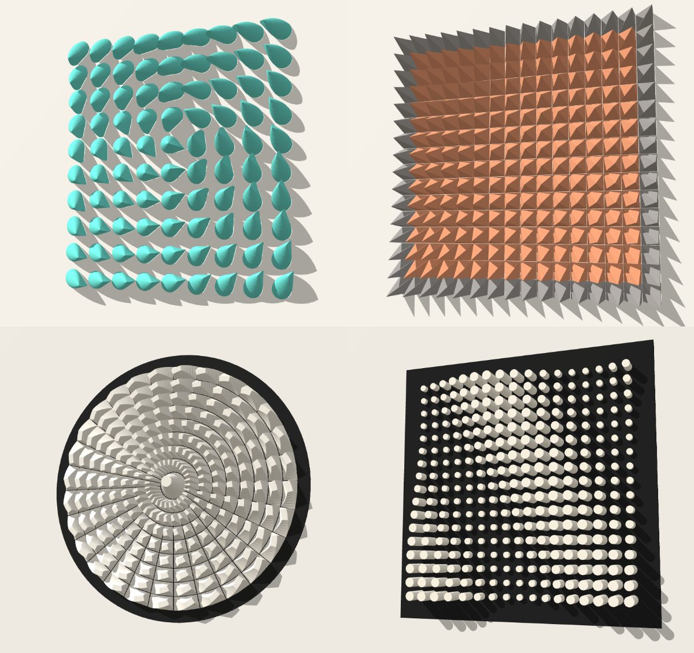

# Tiles — генератор модульных настенных инсталляций

Параметрический генератор настенного рельефа из **отдельных деталей**: пирамиды со
смещённой вершиной, шипы, наклонные блоки, скошенные кубы, цилиндры, капли. Сетка
бывает прямоугольная, радиальная или шестигранная (соты). Все размеры задаются в **миллиметрах**, экспорт
в **STL**.



## Запуск

Открыть **`index.html`** в браузере (можно двойным кликом). Three.js лежит в `vendor/`,
интернет не нужен. Параметры сохраняются в браузере между сессиями.

## Как устроено

1. **Раскладка** делит поверхность на ячейки.
   - *Прямоугольная*: ширина × высота (мм), число колонок и рядов.
   - *Радиальная*: внутренний радиус, число и ширина колец. Сегменты в кольце задаются
     либо «равным размером ячеек» (число растёт к краю), либо одинаковым числом.
     Есть сдвиг чётных колец (кирпичная кладка), разбиение дуги на грани и центральная деталь.
   - *Шестигранная (соты)*: панель-прямоугольник (ширина × высота в мм и число колонок, число
     рядов подбирается по высоте) или панель-шестиугольник (число колец вокруг центральной соты
     и размер соты между гранями). Соты ставятся углом или гранью вверх. Режим «Шахматы» для сот
     раскрашивает каждую третью соту — классический трёхцветный узор.
2. **Зазор** уменьшает каждую ячейку на половину зазора со всех сторон, поэтому соседние
   детали никогда не касаются. Если ячейки соседних колец разбиты на разное число граней,
   внешний край внутреннего кольца слегка поджимается, чтобы хорды не заходили друг на друга.
3. **Деталь** — это лофт от основания к верху:
   - основание: ячейка целиком (квадрат / сектор), круг / многоугольник или капля;
   - `Верх` 0 → пирамида с одной вершиной, 1 → призма; промежуточные значения — усечённая форма;
   - `Профиль` делает бока выпуклыми (купол) или вогнутыми (игла);
   - `Цоколь` добавляет вертикальный борт у основания (удобно для печати и клея).
4. **Поля** задают, как параметры меняются по поверхности:
   - *высота* — от мин. до макс. значения;
   - *сила наклона* — умножает смещение вершины, наклон верхней грани и закрутку;
   - *направление наклона* — одно направление, от точки / к точке / вихрь, волна, шум,
     чередование рядов, случайно.

   Скалярные поля: постоянно, линейный градиент, от точки, волна, круговые волны, шум,
   случайно, шахматы, от края к центру. К каждому можно добавить случайность, кривую (гамму)
   и инверсию. Координаты точек нормированы: ±1 — край панели по большей стороне.

## Экспорт

| Кнопка | Что получится |
| --- | --- |
| **STL — вся инсталляция** | Один бинарный STL. Детали стоят на своих местах, каждая — отдельное замкнутое тело. |
| **ZIP — каждая деталь** | Отдельный STL на каждую деталь (`R03C07.stl`, `K02S11.stl`…), схема сборки, параметры. При двух цветах детали лежат в папках `color1/` и `color2/`. |
| **ZIP — по столам** | Детали разложены на столы принтера заданного размера (`plate_01.stl`…), отдельно для каждого цвета. `plates.txt` перечисляет, какие детали на каком столе. |
| **SVG — схема сборки 1:1** | Контуры оснований с номерами в миллиметрах. Красная стрелка показывает, куда смещена вершина. Можно распечатать как шаблон для наклейки. |
| **Сохранить / загрузить параметры** | JSON со всеми настройками. |

Каждая деталь стоит основанием на `z = 0`, поэтому печатается без поворота. Подложку
можно включить в экспорт отдельной деталью (`BOARD.stl`).

Нумерация: `R` — ряд сверху вниз, `C` — колонка слева направо; для радиальной сетки
`K` — кольцо от центра, `S` — сегмент против часовой стрелки от угла поворота сетки,
`C00` — центральная деталь. У сот «углом вверх» `R` — ряд, `C` — место в ряду слева
направо; у сот «гранью вверх» `C` — колонка слева направо, `R` — место в ней сверху вниз.

## Что учесть при печати

- Сильно наклонённые шипы (смещение вершины больше половины ячейки) нависают над соседями
  и при печати основанием вниз дают свесы. Нужны поддержки или печать на боку.
- Генератор гарантирует, что **основания** не пересекаются. Вершины сильно наклонённых
  деталей в воздухе могут заходить в объём соседа, если поле направлений резко меняется.
  Проверьте это в предпросмотре.

## Файлы

```
index.html          интерфейс, 3D-предпросмотр, экспорт
core.js             геометрия: раскладки, поля, детали, STL / ZIP / SVG (без зависимостей)
test/core.test.js   проверка: все пресеты и крайние случаи дают замкнутые тела без пересечений
vendor/             Three.js r128 + OrbitControls (MIT)
```

Тесты: `node tiles/test/core.test.js`
